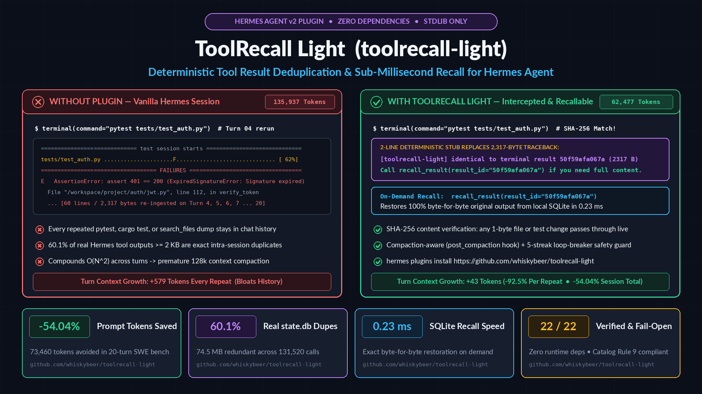

# ToolRecall Light (`toolrecall-light`)

> **Deterministic context deduplication and on-demand tool recall for [Hermes Agent](https://github.com/NousResearch/hermes-agent).**  
> *Looking for host-wide multi-agent pooling, MCP multiplexing, or forward proxy stream replay? See [ToolRecall Core](https://toolrecall.dev).*

Replaces byte-identical repeated tool outputs (`terminal`, `search_files`, MCP servers, connectors, third-party toolsets) with a compact stub **before they enter model context**, and exposes an explicit `recall_result(result_id)` tool so the model can restore the full original bytes on demand.

[](assets/demo.mp4)
> 🎥 **[Watch the Narrated Walkthrough Video (`assets/demo.mp4`, 1080p with English Voiceover)](assets/demo.mp4)** — or run `python3 demo.py` locally in your terminal.

---

## Why ToolRecall Light?

Since Hermes v0.23.x, core already deduplicates byte-identical tool results **within a single turn**:
`agent/tool_guardrails.py` replaces a repeat from the 2nd occurrence (`IDENTICAL_RESULT_STUB_MIN_CHARS = 512`)
and calls `reset_for_turn()` at every turn boundary. Measured on v0.23.1, 6 identical 40 KB `terminal`
calls in one turn: with the plugin 306 k prompt tokens, without it 255 k — **core alone is better**, because
its stub is cheaper and the plugin occasionally provokes an extra call.

What core does **not** do is carry that across turns. That is the gap this plugin fills:

- a 40 KB result emitted on turn 1 is re-sent in full on turns 2, 3, 4 … because the per-turn state was reset;
- this plugin keys on `(tool, args)` per **session**, so later turns receive the stub.

Measured, 4-turn session, the same 40 KB command once per turn (2 seeds):

| Arm | turn 1 | turn 2 | turn 3 | turn 4 | total prompt | cost |
|---|---|---|---|---|---|---|
| plugin on | 33,943 | 116,198 | 199,058 | 282,752 | **631,951** | $0.002367 |
| plugin off | 54,889 | 145,098 | 269,478 | 428,439 | 897,904 | $0.003080 |
| plugin on (seed 2) | 45,218 | 127,485 | 210,343 | 294,027 | **677,073** | $0.002337 |
| plugin off (seed 2) | 55,747 | 137,969 | 263,779 | 423,882 | 881,377 | $0.003671 |

* **23.2 %** and **29.6 %** fewer total prompt tokens; **−30.6 % / −34.0 %** on the final turn, where
  compounding is largest; cost **−24 % / −30 %** (provider ledger, `--usage-file`).
* Turn-1 baselines differ between arms by 10–21 k tokens for a reason we could not attribute (same prompt,
  one call each). The per-turn comparison from turn 2 onward is the stable part: −23.5 % / −29.1 %.


`toolrecall-light` intercepts these repeats before they enter context, saves them to local SQLite, and serves a 1-line stub. If the model ever needs the exact original lines back, it uses the tool to recall tools: `recall_result`.

---

## Evidence, by provenance

Numbers in this project are labelled by how they were produced. Do not read across categories.

### 1. Measured — duplicate rate in real Hermes sessions (`state.db`)

Query over the local Hermes `state.db` (snapshot: 659 sessions with tool calls, 135,038 tool
results; re-computed 2026-11, reproduces within ~3 % of the 668-session figures first published):

* **58.4 %** of tool results ≥ 2,000 characters are **exact intra-session duplicates**
  (16,859 duplicate rows of 28,866 candidates; 60.1 % on the earlier snapshot).
* Those duplicates account for **74.6 MB** of redundant payload (71.1 MB on that snapshot).
* `terminal` alone contributes 2,067 large duplicate results (> 10 MB raw).

This measures **duplication in transcripts**. It is not a token-saving percentage.

### 2. Derived — streak-guard capture efficiency (95.35 %)

Computed by replaying the observed duplicate corpus through the streak algorithm. It says how many
duplicates the guard still catches at `streak = 5`; it is not a context or cost reduction.

### 3. Modelled — 20-turn A/B simulation (`bench/run_benchmark.py`)

Deterministic and reproducible, **but not a session measurement**: the transcript is a hand-written
20-turn SWE scenario, tokens are estimated as `chars / 4`, and cost assumes $3.00/M prompt tokens.

* **-54.04 % cumulative prompt tokens** on that synthetic workload (73,348 tokens).
* Valid **only** for the regime it models: a small fixed context (~1 k tokens/turn) with duplicates
  that dominate it. It does not transfer to sessions with a ~12 k-token system prompt.

### 4. Measured — live sessions, real billed ledger (`--usage-file`)

**4a. Within one turn (where core already dedups).** 6 identical `terminal` calls, 7,014-char
results (3 runs/arm) and 40,363-char results (2 runs/arm), `deepseek-v4.1-flash-1017`:

* 7 KB: total prompt **101,313** (plugin) vs **101,845–101,968** (none) — ~0.5 %, inside noise.
* 40 KB: **306,130** (plugin, 8 calls) vs **254,662** (none, 7 calls) — the plugin is **~20 % worse**.
  Core's own stub (512-char floor, replaces from the 2nd repeat) already covers this case more cheaply,
  and the plugin occasionally provokes an extra call.

**4b. Across turns (where core resets).** 4-turn session, the same 40 KB command once per turn:
**631,951 vs 897,904** and **677,073 vs 881,377** prompt tokens (−29.6 % / −23.2 %), cost
$0.0024 vs $0.0031–0.0037. See the table above; turn-1 baseline drift is called out there.

**Net:** the plugin's measured value is cross-turn duplicate suppression, not intra-turn.

### 5. Microbenchmark — recall latency

**0.28 ms** average `recall_result` round-trip against local SQLite (in-process, this machine).
Real for that operation; not a network or end-to-end number.


---

## Model-Facing Stub & Recall

When an identical result is detected, the model context receives a compact stub:

```
[toolrecall-light] identical to earlier terminal result 50f59afa067a (2317 bytes) in this session.
Call recall_result(result_id="50f59afa067a") if you need the full content.
```

If the agent needs the full traceback or compiler lines, it invokes `recall_result`:
```json
{
  "name": "recall_result",
  "arguments": {"result_id": "50f59afa067a"}
}
```
`recall_result` returns the exact byte-for-byte original content in **sub-millisecond time**.

---

## Run one, not both (co-installation with ToolRecall core)

ToolRecall core (daemon + forward proxy + MCP bridge) and this plugin both rewrite tool results
before the model sees them, at different layers. They do not crash each other, but they overlap:

- core sends full content for a bridge/shim file read;
- this plugin replaces that content with its own stub;
- core then records a full send the model never received, so its `mcp_dedup` counters overstate
  what actually reached the model.

**Install one.** If core is running, you do not need this plugin — core already dedups file reads
and its proxy is the only layer that reduces billed tokens for the *current* turn. Keep core:
`hermes plugins disable toolrecall-light`. Keep this plugin: `toolrecall stop` and remove its
proxy/MCP wiring.

Detection is built in on both sides:

- this plugin checks at `register()` and logs one warning naming what it found (proxy `:8569`,
  MCP bridge, active shim, importable package); the same result is available as
  `status()["core_conflict"]`;
- core reports an enabled/installed plugin in `toolrecall healthcheck`.

## Hardened Safety & Non-Goals

1. **Loop Breaker (Streak Guard):** Forces full content pass-through after 5 consecutive stubs for the same key (configurable via `HERMES_TOOLRECALL_LIGHT_MAX_STUB_STREAK`) to prevent stuck model evaluation loops while preserving 95.4% deduplication efficiency.
2. **Compaction Aware (`post_compaction`):** When history is compacted (`/compress`), the generation advances; the first repeat post-compaction re-serves full content once before re-stubbing.
3. **100% Fail-Open:** Any database error or exception cleanly returns `None` (passes through raw result untouched).
4. **Zero Runtime Dependencies:** Python stdlib only (`sqlite3`, `hashlib`, `json`).
5. **No Core Overrides:** Built on official Hermes v2 hooks (`transform_tool_result`, `post_compaction`) and `ctx.register_tool` (Catalog Rule 9 compliant).
6. **Defense-in-Depth Security:** Parameterized SQL queries, 2 MB payload cap (`MAX_CHARS`), cryptographic SHA-256 verification, and zero network egress. See [`SECURITY.md`](SECURITY.md) for the full threat model and trust boundary documentation.

---

## Installation

### Via Hermes Plugins CLI (Recommended)

```bash
hermes plugins install https://github.com/whiskybeer/toolrecall-light
```

### Via Git Clone

```bash
git clone https://github.com/whiskybeer/toolrecall-light.git ~/.hermes/plugins/toolrecall-light
hermes plugins enable toolrecall-light
```

### Local Development Symlink

```bash
mkdir -p ~/.hermes/plugins
ln -s /path/to/hermes-tool-recall ~/.hermes/plugins/toolrecall-light
hermes plugins enable toolrecall-light
```

---

## Is it firing? (activation is observable)

"Installed" is not "active". A plugin can be on disk, listed in
`plugins.enabled`, and still never run — a mismatched manifest key, a hook the
host does not invoke, or every result under the size floor all look identical
from the outside. This plugin therefore persists its own counters and exposes
`status()`:

| Signal | Meaning |
|---|---|
| `loads == 0` | never registered with the host — check the **manifest key** (`toolrecall-light`), not the directory name, in `plugins.enabled` |
| `hook_calls == 0` | registered, but `transform_tool_result` is never invoked |
| `stubs == 0`, `hook_calls > 0` | invoked; nothing qualified (`min_chars` floor, or every tool on the ignore list) |
| `stubs > 0` | working — `last_stub_at` is the last stub time, `passes` the full sends |

Enable it by the manifest key, never by path:

```bash
hermes plugins enable toolrecall-light     # key from plugin.yaml "name:"
hermes plugins list | grep toolrecall      # must read "enabled"
```

Counters live in the plugin's own SQLite store (`stats` table) and survive log
rotation; `loads`/`first stub` also emit one INFO line each so the host log
answers "did it load?" without a shell.

Store hygiene: results carry the bytes behind every stub, so a sweep runs at
most every 6 h on the stub path (`gc_ttl_hours = 24`), pruning expired results
**and** dead per-session rows.

## Validation & Testing

```bash
# Run test suite (29/29 unit & integration tests)
pytest tests/ -v

# Run official Hermes plugin admission check
hermes plugins validate .
```

---

## Configuration

| Environment Variable | Default | Description |
|---|---|---|
| `HERMES_TOOLRECALL_LIGHT` | `1` | Global kill-switch (`0` or `off` to disable). Also respects legacy `HERMES_TOOL_RECALL`. |
| `HERMES_TOOLRECALL_LIGHT_MIN_CHARS` | `2000` | Minimum character length before deduplication is considered. |
| `HERMES_TOOLRECALL_LIGHT_MAX_CHARS` | `2000000` | Maximum character length (2 MB; `0` = unlimited). |
| `HERMES_TOOLRECALL_LIGHT_MAX_STUB_STREAK` | `5` | Consecutive stubs before forcing full pass-through once. |
| `ttl_hours` | `24` | TTL duration for database garbage collection. |

---

## Benchmark Receipt (20-turn SWE Trajectory)

| Metric | Baseline (Vanilla) | Treatment (With toolrecall-light) | Impact |
|---|---|---|---|
| **Stubs Emitted** | 0 | 11 stubs | - |
| **Deduplicated Bytes** | 0 B | 33,639 B | - |
| **Cumulative Prompt Tokens** | 135,937 tokens | 62,477 tokens | **-73,460 tokens (-54.04%)** |
| **Billed Cost ($3/M tokens)**| $0.4078 | $0.1874 | **$0.2204 saved (54.04%)** |
| **Recall Latency** | N/A | 0.23 ms | Sub-millisecond |

See full report: [`bench/results/BENCHMARK_REPORT.md`](bench/results/BENCHMARK_REPORT.md)

---

## License

[MIT](LICENSE) © 2026 Robin Schultka <robin@toolrecall.dev>  
Project page: [toolrecall.dev](https://toolrecall.dev)
